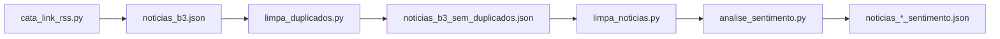
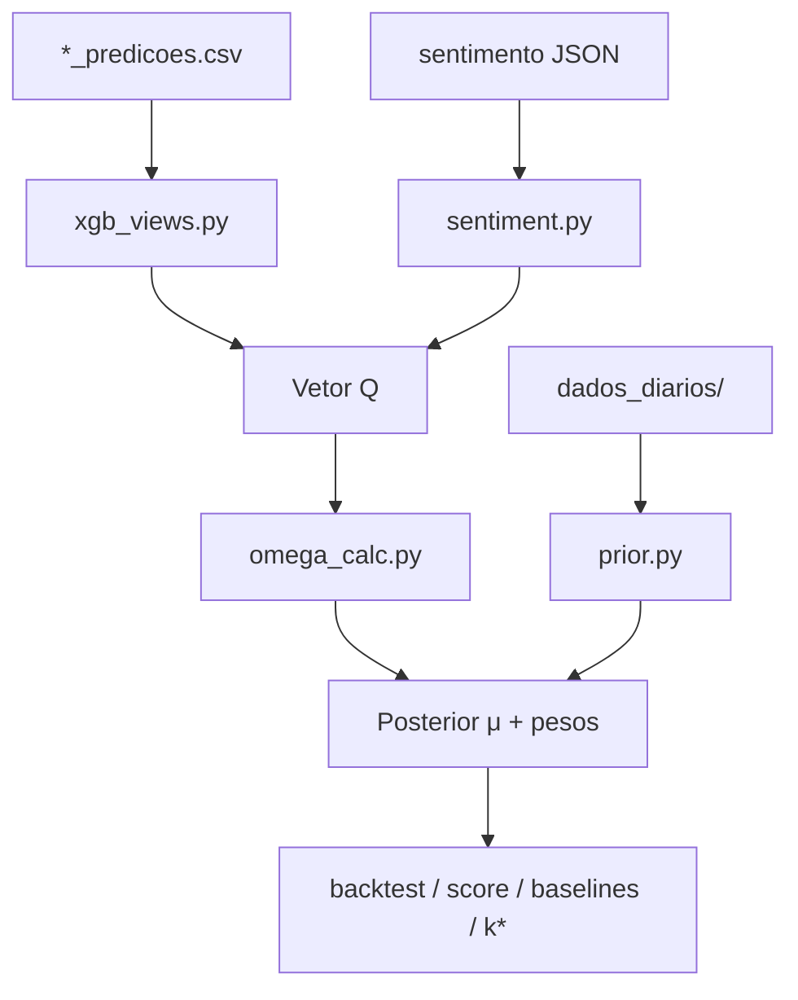

# Toledo Portfolio Optimization

Pipeline de pesquisa para **otimização de portfólio na B3** combinando views quantitativas (XGBoost), sentimento de manchetes e o modelo **Black-Litterman**.

Fonte de verdade dos parâmetros: [`intel/Blacklitterman/config.py`](intel/Blacklitterman/config.py), gravada a partir de [`outputs/optimize/melhorias_bl_wf_best.json`](intel/Blacklitterman/outputs/optimize/melhorias_bl_wf_best.json) (walk-forward, **k\* = 5**, escolhido na validação 2024). Não usar os defaults antigos (universo de 5 ativos, α = 0,50, τ = 0,025, teto 35%).

```
tickers_data + dados_diarios + notícias (2023–2025)
        ↓
criacao_modelo_xgb/*_predicoes.csv  (views quantitativas, walk-forward OOF)
        ↓
Views Q (XGB + sentimento, com gate de notícias) → Ω → Prior π → Posterior μ → Pesos
        ↓
Avaliação (backtest, score, Markowitz, sensibilidade, k*)
```

> **Decisão arquitetural:** o único modelo quantitativo do vetor Q é o **XGBoost**. O Black-Litterman não treina; consome `criacao_modelo_xgb/*_predicoes.csv`.

Material de metodologia para o TCC: [`TCC_MATERIAL_REPOSITORIO.md`](TCC_MATERIAL_REPOSITORIO.md). Guia narrativo do BL: [`intel/Blacklitterman/COMO_FUNCIONA.md`](intel/Blacklitterman/COMO_FUNCIONA.md).

---

## Universo e janelas

20 ações líquidas da B3 (sufixo `.SA` no prior/yfinance):

ABEV3, B3SA3, BBAS3, BBDC4, CMIG4, EQTL3, GGBR4, ITUB4, LREN3, MGLU3, PETR3, PETR4, PRIO3, RADL3, RAIL3, SANB11, SBSP3, SUZB3, VALE3, WEGE3.

| Uso | Período |
|-----|---------|
| Preços de treino | 2018-01-01 até hoje |
| Notícias | 2023-01-01 a 2025-12-31 |
| Prior Σ / π | 2023-01-01 a 2025-12-31 |
| Validação (escolhe hiperparâmetros) | 2024 |
| Teste / relatório | 2025 |

Capital inicial do backtest: **R$ 100.000**. Execução com lag de **1 dia útil** e custo de **10 bps** sobre o turnover. Proxy de Selic: **15% a.a.** (constante).

---

## Estrutura do projeto

```
toledo-portfolio-optimizationn/
├── .env                           # OPENAI_API_KEY (não versionar)
├── requirements.txt
├── TCC_MATERIAL_REPOSITORIO.md    # metodologia, fórmulas, snapshots
├── dados_diarios/                 # OHLCV diário + features vs IBOV
├── tickers_data/                  # barras horárias 60 min (só PI_incerteza.py)
├── criacao_modelo_xgb/            # artefatos XGB (entrada Q do BL)
└── intel/
    ├── model_training/            # download → features → treino XGB
    ├── data_acquisition/          # RSS → limpeza → sentimento GPT
    └── Blacklitterman/            # Q → Ω → π → μ → pesos → avaliação
        └── outputs/               # CSV e PNG
```

---

## Pré-requisitos de dados

### 1. Predições XGBoost (`criacao_modelo_xgb/`)

| Arquivo | Uso |
|---------|-----|
| `TICKER_predicoes.csv` | `date`, `y_pred`, `y_real` — views OOF do vencedor (horizonte eleito) |
| `metricas_vencedores.csv` | horizonte e tipo (regressor vs classificador) por ticker |

### 2. Preços diários (`dados_diarios/`)

CSV por ticker com pelo menos `date` e `close`. Também `IBOV.csv` e `USDBRL.csv`.

### 3. Notícias com sentimento

`intel/data_acquisition/noticias_b3_sem_duplicados_sentimento.json`.

Corpus atual (coleta 2023–2025, modelo `gpt-5.6-luna`):

| Estágio | Quantidade |
|---------|------------|
| RSS bruto (`noticias_b3.json`) | 7.835 |
| Sem duplicata + sentimento | 4.681 |
| Com link real (Playwright, incompleto) | 2.920 |

Das 4.681 classificadas: **2.418 positivas**, **1.253 negativas**, **1.010 neutras**. Por ano de publicação: 2023 = 826, 2024 = 1.374, 2025 = 2.480.

No vetor Q de 2025 (20 × 250 dias), **73,3%** dos dias-ativo não têm manchete e só **1,5%** têm 5 ou mais. Com o gate vigente isso faz o hard prior valer na maior parte dos dias.

O JSON ainda pode conter tickers legados (ITUB3, BBDC3). `sentiment.py` agrupa pela empresa (PETR3/PETR4 compartilham notícias da Petrobras).

---

## Como executar

### 1. Ambiente

```bash
python -m venv venv
venv\Scripts\activate          # Windows
pip install -r requirements.txt
```

`.env` na raiz (só para reclassificar sentimento):

```
OPENAI_API_KEY=sk-...
```

### 2. Predições XGBoost (quando for regenerar Q)

```bash
cd intel/model_training
python pipeline.py              # download + features + treino
```

Horizontes competindo: **5, 10 e 21** dias. O vencedor por ticker é o maior `dir_acc` OOF (regressor vs classificador).

### 3. Notícias (quando for regenerar sentimento)

```bash
cd intel/data_acquisition
python cata_link_rss.py
python limpa_duplicados.py
python limpa_noticias.py
python analise_sentimento.py
```

Tickers da coleta: os mesmos 20 do BL. Idioma/país: pt-BR / BR.

### 4. Black-Litterman e avaliação

```bash
cd intel/Blacklitterman
python pipeline.py
python plot_ganho_estimado.py
python score_modelo.py
python comparar_bl_vs_markowitz.py
```

Pesquisa (já refletida no `config.py` vigente):

```bash
python otimizar_parametros.py
python melhorias_bl_wf.py
python sensibilidade_universo.py
python sensibilidade_tamanho_universo.py
```

---

## Pipeline de notícias



Classificação: **positivo / negativo / neutro** via `gpt-5.6-luna`. O BL agrega por dia e ticker:

\[
\mathrm{sentiment\_signal} = \tanh(\mathrm{média} \cdot \log(1 + n))
\]

---

## Pipeline Black-Litterman



Gate de cobertura (`NEWS_COUNT_MIN = 5`):

\[
c = \min(1,\ n / 5)
\]

\[
Q_h = [\alpha + (1-\alpha)(1-c)]\, r_{\mathrm{pred}} + (1-\alpha)\, c \cdot (\mathrm{sentimento} \times \mathrm{escala})
\]

Sem notícias, \(Q = r_{\mathrm{pred}}\). Com cobertura cheia, mistura clássica. Depois \(Q = Q_h / h\) para alinhar ao prior diário. Com `HARD_PRIOR_WHEN_LOW_NEWS = True`, se \(n < 5\) a view é ignorada (confiança vai a epsilon) e o dia fica no prior de mercado. Abaixo do mínimo, Ω também é multiplicado por `NEWS_OMEGA_BOOST` ≈ 3,80.

α vigente ≈ **0,386** (mais peso no sentimento quando a cobertura está cheia; na prática o gate anula o sentimento na maior parte dos dias).

Posterior:

```
μ = [(τΣ)⁻¹ + P'Ω⁻¹P]⁻¹ [(τΣ)⁻¹π + P'Ω⁻¹Q]
```

Pesos: long-only, teto ≈ **34,2%** por ativo, rebalance **monthly** (também gera daily e weekly). Prior rolling com no mínimo **80** observações estritamente anteriores ao dia. τ ≈ **0,0147**.

### Resultado vigente (k\* = 5, teste 2025)

Escolha de k na validação 2024; teste congelado. Subconjunto top-5, parâmetros do `config.py`:

| Estratégia | Sharpe | Retorno | Capital final | Max drawdown |
|------------|--------|---------|---------------|--------------|
| BL no top-5 | 0,85 | +15,2% | R$ 114,0 mil | −9,6% |
| Híbrido (rank XGB + Markowitz) | 0,40 | +7,4% | R$ 106,0 mil | −11,3% |
| Markowitz clássico no mesmo top-5 | −0,12 | −2,5% | R$ 96,2 mil | −18,4% |

Arquivos: `outputs/optimize/melhorias_bl_wf_best.json`, `outputs/score/melhorias_bl_wf_kstar_metricas.csv`, `outputs/figures/melhorias_bl_wf_kstar_capital.png`.

`outputs/optimize/optimization_summary.json` e `outputs/markowitz/bl_vs_markowitz_resumo.csv` são de um Optuna anterior (teto ≈ 42,7%, mínimo de 2 notícias, hard prior desligado). Não misturar com os números acima.

---

## Parâmetros vigentes

| Parâmetro | Valor | Papel |
|-----------|-------|--------|
| `ATIVOS` | 20 tickers `.SA` | Universo |
| `ALPHA_Q` | 0,386251 | Peso do XGB vs sentimento (cobertura cheia) |
| `TAU` | 0,0147235 | Escala da incerteza do prior |
| `MAX_WEIGHT_PER_ASSET` | 0,341677 | Teto long-only |
| `NEWS_COUNT_MIN` | 5 | Gate de manchetes |
| `NEWS_OMEGA_BOOST` | 3,79598 | Multiplica Ω se n < mínimo |
| `HARD_PRIOR_WHEN_LOW_NEWS` | True | View ignorada se n < mínimo |
| `ROLLING_MIN_OBS` | 80 | Mínimo do prior rolling |
| `W_MODEL_CONF` / `W_NEWS_CONF` | 0,659 / 0,341 | Pesos da confiança em Ω |
| `OPT_DEFAULT_REBALANCE_MODE` | monthly | Modo do tuning |
| `RISK_FREE_ANNUAL` | 0,15 | Selic proxy |
| `TRANSACTION_COST_BPS` | 10 | Custo de turnover |
| `EXECUTION_LAG_DAYS` | 1 | Lag de execução |

---

## Dependências

| Categoria | Pacotes |
|-----------|---------|
| Core | pandas, numpy, scikit-learn, matplotlib, joblib |
| Dados | yfinance |
| ML | xgboost, optuna |
| Sentimento | openai, python-dotenv |
| Notícias | feedparser |
| Opcional | shap, lightgbm, playwright |

---

## Referências internas

- [`intel/Blacklitterman/README.md`](intel/Blacklitterman/README.md) — módulo BL
- [`intel/Blacklitterman/COMO_FUNCIONA.md`](intel/Blacklitterman/COMO_FUNCIONA.md) — fluxo narrativo
- [`intel/Blacklitterman/outputs/README.md`](intel/Blacklitterman/outputs/README.md) — mapa das saídas
- [`TCC_MATERIAL_REPOSITORIO.md`](TCC_MATERIAL_REPOSITORIO.md) — metodologia completa
