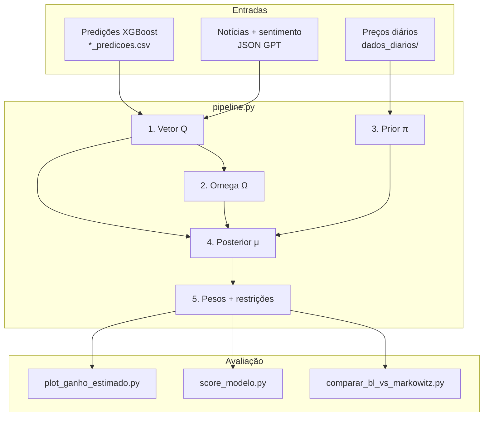

# Material técnico do repositório — apoio ao TCC

**Projeto:** Toledo Portfolio Optimization  
**Repositório:** `toledo-portfolio-optimizationn`  
**Objetivo deste documento:** descrever, de forma extensiva, a finalidade, a arquitetura, os pipelines, as premissas, as fórmulas, os parâmetros e as saídas do código, para uso em sumário, metodologia e apêndices do TCC.

> **Fonte de verdade:** o código em `intel/*/config.py` e os módulos Python.  
> O `README.md` raiz e partes de `COMO_FUNCIONA.md` ainda descrevem um universo antigo de **5 ativos**; a configuração vigente usa **20 tickers**.

---

## Índice

1. [Finalidade e pergunta de pesquisa](#1-finalidade-e-pergunta-de-pesquisa)
2. [Enquadramento teórico resumido](#2-enquadramento-teórico-resumido)
3. [Arquitetura do repositório](#3-arquitetura-do-repositório)
4. [Universo de ativos e dados](#4-universo-de-ativos-e-dados)
5. [Visão geral do pipeline end-to-end](#5-visão-geral-do-pipeline-end-to-end)
6. [Pipeline A — dados e treino XGBoost](#6-pipeline-a--dados-e-treino-xgboost)
7. [Pipeline B — notícias e sentimento](#7-pipeline-b--notícias-e-sentimento)
8. [Pipeline C — Black-Litterman](#8-pipeline-c--black-litterman)
9. [Avaliação, score e baselines](#9-avaliação-score-e-baselines)
10. [Otimização de hiperparâmetros (Optuna)](#10-otimização-de-hiperparâmetros-optuna)
11. [Análises de sensibilidade](#11-análises-de-sensibilidade)
12. [Premissas (lista explícita)](#12-premissas-lista-explícita)
13. [Parâmetros oficiais (config atual)](#13-parâmetros-oficiais-config-atual)
14. [Resultados materializados (snapshots)](#14-resultados-materializados-snapshots)
15. [Ordem de execução e dependências](#15-ordem-de-execução-e-dependências)
16. [Mapa de saídas](#16-mapa-de-saídas)
17. [Limitações e inconsistências documentais](#17-limitações-e-inconsistências-documentais)
18. [Sugestão de estrutura de capítulos do TCC](#18-sugestão-de-estrutura-de-capítulos-do-tcc)
19. [Glossário](#19-glossário)
20. [Referências internas do repositório](#20-referências-internas-do-repositório)

---

## 1. Finalidade e pergunta de pesquisa

O repositório implementa um **pipeline de pesquisa** (não uma aplicação web) para **otimização de portfólio de ações da B3**, combinando:

| Fonte | Tecnologia | Papel |
|-------|------------|--------|
| Views quantitativas | XGBoost (walk-forward OOF) | Log-retorno esperado por ativo |
| Views qualitativas | GPT sobre manchetes | Viés positivo / negativo / neutro |
| Equilíbrio de mercado | Prior Black-Litterman | Opinião implícita via market cap + Σ |
| Alocação | Posterior BL + restrições | Pesos long-only com teto por ativo |
| Avaliação | Backtest + score + baselines | Capital, Sharpe, drawdown vs Markowitz/Selic |

### Pergunta operacional

> Como alocar capital entre um conjunto de ações líquidas da B3, combinando previsões de machine learning, sentimento de notícias e a teoria de equilíbrio de mercado, de forma que a **confiança** em cada opinião controle o quanto ela altera o portfólio?

### Decisão arquitetural explícita

O único modelo quantitativo que alimenta o vetor de views \(Q\) é o **XGBoost**. O módulo Black-Litterman **não treina** o XGB: consome artefatos já gerados em `criacao_modelo_xgb/*_predicoes.csv`.

### Frase-síntese (abstract em uma linha)

O projeto combina previsões out-of-fold de XGBoost e sentimento de notícias (GPT) em views Black-Litterman com incerteza dinâmica, prior de equilíbrio de mercado rolling e restrições long-only, para alocar um portfólio de 20 ações da B3 e avaliá-lo em backtest com custos e comparação a Markowitz e Selic.

---

## 2. Enquadramento teórico resumido

### 2.1 Por que não só Markowitz?

O mean-variance clássico (Markowitz) estima retornos esperados pela média histórica. Médias de retorno são ruidosas; a otimização responde com pesos extremos e instáveis. O modelo **Black-Litterman (1992)** parte do equilíbrio de mercado e permite incorporar **views** do investidor com níveis de confiança.

### 2.2 Por que views de ML + sentimento?

- **ML (XGBoost):** captura padrões não lineares em features de preço, volume, relativo ao Ibovespa e macros setoriais; produz uma opinião quantitativa calibrada em escala de log-retorno.
- **Sentimento (GPT):** injeta informação qualitativa de manchetes que o preço pode ainda não ter absorvido plenamente; sozinho é ruidoso e precisa ser escalado para unidade de retorno.
- **BL:** mistura as duas fontes com o prior de mercado, ponderando pela matriz de incerteza \(\Omega\).

### 2.3 Hipótese operacional implícita no código

Um portfólio que combina (i) views OOF de XGBoost, (ii) sentimento diário de manchetes e (iii) prior de equilíbrio, com \(\Omega\) dinâmico e restrições long-only, pode gerar alocações avaliáveis contra Markowitz puro e Selic em janela out-of-sample (**2025**), após tuning em validação (**2024**).

---

## 3. Arquitetura do repositório

```
toledo-portfolio-optimizationn/
├── .env                              # OPENAI_API_KEY (gitignored)
├── .gitignore
├── requirements.txt
├── README.md                         # visão geral (parcialmente desatualizada)
├── TCC_MATERIAL_REPOSITORIO.md       # este documento
│
├── dados_diarios/                    # OHLCV diário + features vs IBOV
│   ├── ABEV3.csv … WEGE3.csv         # 20 ações
│   ├── IBOV.csv                      # benchmark
│   └── USDBRL.csv                    # macro cambial
│
├── tickers_data/                     # barras horárias B3 60 min
│   └── BMFBOVESPA_DLY_<TICKER>, 60.csv
│
├── criacao_modelo_xgb/               # artefatos XGB (entrada Q do BL)
│   ├── <TICKER>_predicoes.csv        # ★ walk-forward OOF
│   ├── <TICKER>_h{5,10,21}d_*        # artefatos por horizonte
│   ├── metricas_vencedores.csv       # horizonte/modelo eleito
│   ├── q_vetor.csv / omega_base.csv
│   └── *.pkl, *.json, *.png, shap…
│
└── intel/                            # todo o código de pesquisa
    ├── __init__.py
    ├── model_training/               # download → features → treino XGB
    ├── data_acquisition/             # RSS → limpeza → sentimento GPT
    └── Blacklitterman/               # Q → Ω → π → μ → pesos → avaliação
```

### Separação de responsabilidades

| Camada | Pasta | Produz | Consome |
|--------|-------|--------|---------|
| Dados de preço | `dados_diarios/`, `tickers_data/` | Séries OHLCV | Treino + prior + backtest |
| Inteligência quantitativa | `intel/model_training/` → `criacao_modelo_xgb/` | Predições OOF | BL (`xgb_views.py`) |
| Inteligência qualitativa | `intel/data_acquisition/` | JSON com sentimento | BL (`sentiment.py`) |
| Otimização e avaliação | `intel/Blacklitterman/` | Pesos, μ, métricas, figuras | Relatório / TCC |

Não há notebooks (`.ipynb`) no fluxo principal. Tudo é script CLI Python. Saídas ficam em `intel/Blacklitterman/outputs/`.

### Módulos Python por pasta

#### `intel/model_training/`

| Arquivo | Papel |
|---------|--------|
| `config.py` | Paths, janelas de features IBOV, datas de download |
| `download_daily.py` | yfinance → `dados_diarios/` |
| `prepare_features.py` | Features relativas ao IBOV |
| `train_xgb.py` | Walk-forward OOF, Optuna, horizontes, clf vs reg |
| `pipeline.py` | Orquestra download → features → train |

#### `intel/data_acquisition/`

| Arquivo | Papel |
|---------|--------|
| `config.py` | Paths JSON, 20 tickers RSS, modelo GPT, filtros de título |
| `cata_link_rss.py` | Google News RSS → `noticias_b3.json` |
| `limpa_duplicados.py` | Dedup por título |
| `limpa_noticias.py` | Remove títulos sem menção ao ticker/empresa |
| `analise_sentimento.py` | Classificação positivo/negativo/neutro via OpenAI |
| `traduz_link_do_rss.py` | Resolve `link_google` → link real (Playwright) |
| `extrair_search_xml.py` | Extrai `search.xml` → JSON/CSV |
| `ordenar_noticias_por_data.py` | Ordena extract por data |

#### `intel/Blacklitterman/`

| Arquivo | Papel |
|---------|--------|
| `config.py` | Paths, universo, α/τ/Ω, Optuna, custos, saídas |
| `params.py` | Dataclass `BLParams` (hiperparâmetros tunáveis) |
| `pipeline.py` | ★ Entry principal: Q → Ω → π → μ → pesos |
| `xgb_views.py` | Carrega predições, combina com sentimento → Q |
| `sentiment.py` | Agrega sentimento diário do JSON GPT |
| `omega_calc.py` | Ω dinâmico |
| `prior.py` | π, posterior BL, controles, rebalance |
| `weights.py` | Projeção long-only com teto |
| `io_utils.py` | CSV com coluna de data |
| `backtest.py` | Séries de capital, turnover/custo, métricas |
| `plot_ganho_estimado.py` | Backtest estimado vs realizado vs Selic |
| `score_modelo.py` | Score composto 0–100 |
| `comparar_bl_vs_markowitz.py` | BL vs Markowitz / equal-weight / prior-only |
| `otimizar_parametros.py` | Optuna (val 2024; teste 2025) |
| `aplicar_melhores_params.py` | Grava best params e reavalia |
| `sensibilidade_universo.py` | Full vs sem ativos fracos |
| `Q.py` / `omega.py` / `PI.py` / `PI_incerteza.py` | Standalone (debug / VWAP) |
| `_check_news_gate.py` | Self-check do gate de notícias |

---

## 4. Universo de ativos e dados

### 4.1 Universo atual (20 ações)

Definido em `intel/Blacklitterman/config.py` e espelhado em `intel/data_acquisition/config.py`:

| Ticker | Observação típica no pipeline |
|--------|-------------------------------|
| ABEV3 | Consumo / bebidas |
| B3SA3 | Bolsa / infraestrutura financeira |
| BBAS3 | Banco público |
| BBDC4 | Banco privado (PN) |
| CMIG4 | Energia (Cemig) |
| EQTL3 | Energia (Equatorial) |
| GGBR4 | Siderurgia (Gerdau) |
| ITUB4 | Banco privado (PN) |
| LREN3 | Varejo (Renner) |
| MGLU3 | Varejo (Magalu) — alta volatilidade |
| PETR3 / PETR4 | Petróleo (ON/PN) |
| PRIO3 | Petróleo (independente) |
| RADL3 | Farmácia (Raia Drogasil) |
| RAIL3 | Logística (Rumo) |
| SANB11 | Banco (unit Santander) |
| SBSP3 | Saneamento (Sabesp) |
| SUZB3 | Celulose (Suzano) |
| VALE3 | Mineração — alvo de sensibilidade (hit direcional fraco) |
| WEGE3 | Bens de capital (WEG) |

No prior/yfinance os tickers usam sufixo `.SA` (ex.: `VALE3.SA`).

### 4.2 Dados auxiliares

| Arquivo | Uso |
|---------|-----|
| `dados_diarios/IBOV.csv` | Features relativas ao mercado; contexto no treino |
| `dados_diarios/USDBRL.csv` | Macro cambial (treino XGB) |
| Macros setoriais opcionais | `brent`, `iron_ore`, `cellulose`, `sugar` (se existirem) |

### 4.3 `tickers_data/` (horário)

CSVs `BMFBOVESPA_DLY_<TICKER>, 60.csv`. Servem para:

1. Definir o universo do download diário.
2. Alimentar `PI_incerteza.py` (prior alternativo com retornos VWAP intradía) — **não** é o caminho principal do `pipeline.py`.

### 4.4 Sensibilidade de universo

```python
ATIVOS_SENSITIVITY_DROP = ["VALE3.SA"]
```

Script: `sensibilidade_universo.py` — compara portfólio full vs sem ativos com acurácia direcional fraca no recorte OOF.

### 4.5 Janelas temporais

| Uso | Início | Fim |
|-----|--------|-----|
| Download diário (treino) | 2018-01-01 | hoje |
| Coleta de notícias | 2023-01-01 | 2025-12-31 |
| Histórico do prior Σ/π | 2023-01-01 | 2025-12-31 |
| Views Q / backtest de comparação | 2025-01 | 2025-12 |
| Optuna validação | 2024-01 | 2024-12 |
| Optuna teste (congelado) | 2025-01 | 2025-12 |

---

## 5. Visão geral do pipeline end-to-end

```text
[1] Preços (yfinance / horários)
        ↓
[2] Features vs IBOV (+ técnicos / macro / ranks)
        ↓
[3] Treino XGB walk-forward OOF (horizontes 5/10/21; reg vs clf)
        ↓
[4] Notícias Google News RSS → limpeza → GPT (pos/neg/neu)
        ↓
[5] Views Q híbridas (XGB + sentimento + gate de cobertura)
        ↓
[6] Ω dinâmico (erro do modelo + notícias + τ·σ)
        ↓
[7] Prior π = δ Σ w_mkt (rolling, ≥60 obs)
        ↓
[8] Posterior BL μ; w ∝ Σ⁻¹μ; long-only + teto
        ↓
[9] Rebalance daily / weekly / monthly
        ↓
[10] Backtest (lag 1 dia, custo 10 bps) + score + vs Markowitz + Optuna
```

Diagrama lógico do BL:



---

## 6. Pipeline A — dados e treino XGBoost

**Pasta:** `intel/model_training/`  
**Orquestração:** `python pipeline.py` (ou etapas `download` / `features` / `train`)  
**Saída:** `criacao_modelo_xgb/`

### 6.1 Download (`download_daily.py`)

- Fonte: **yfinance**
- Início: `DAILY_START_DATE = "2018-01-01"`; fim = hoje (`None`)
- Universo: stems presentes em `tickers_data/`
- Colunas: `date, open, high, low, close, volume, ticker`
- Destino: `dados_diarios/<TICKER>.csv`

### 6.2 Features relativas ao Ibovespa (`prepare_features.py`)

Janelas: **`FEATURE_WINDOWS = [3, 5, 14, 21, 42, 63]`**.

Para cada janela \(N\):

| Feature | Definição (ideia) |
|---------|-------------------|
| `spread_retorno_Nd` | Log-retorno \(N\)d do ativo − log-retorno \(N\)d do IBOV |
| `dist_sma_Nd` | Distância à SMA do ativo relativa à do mercado |
| `spread_vol_Nd` | Volatilidade do ativo − vol do mercado |
| `beta_Nd` | \(\beta\) móvel: \(\mathrm{Cov}(R_a,R_m)/\mathrm{Var}(R_m)\) |
| `spread_volratio_Nd` | Volume relativo vs mercado |
| `z_alpha_Nd` | Z-score do excesso de retorno vs IBOV |
| `trend_mercado_Nd` | Tendência (log-retorno) do IBOV em \(N\) dias |
| `risco_mercado_Nd` | Volatilidade do IBOV |
| `z_mercado_Nd` | Z-score de preço do IBOV |

Também grava `log_ret` e `ibov_log_ret`.

### 6.3 Treino (`train_xgb.py`) — núcleo do vetor Q

**Objetivo declarado no código:** prever o log-retorno de cada ativo no período \(t+h\) e usar o output como vetor \(Q\) (opiniões) do Black-Litterman.

#### Torneio por ticker

1. Horizontes: **`HORIZONS = [5, 10, 21]`** (≈ 1 semana / 2 semanas / 1 mês).
2. Critério de eleição: **`dir_acc_pct`** (acurácia direcional OOF).
3. Compete **regressor** (`XGBRegressor`) vs **classificador 3 classes** (`XGBClassifier`) quando `USE_CLASSIFICATION=True`.
4. O vencedor grava artefatos canônicos (`TICKER_predicoes.csv`, model, params, etc.).

#### Classificador → retorno esperado

\[
Q_{\mathrm{clf}} = P(\mathrm{up})\,\mu_{\mathrm{up}}
  + P(\mathrm{neutral})\,\mu_{\mathrm{neutral}}
  + P(\mathrm{down})\,\mu_{\mathrm{down}}
\]

#### Walk-forward e regularização temporal

| Parâmetro | Valor | Significado |
|-----------|-------|-------------|
| `WF_TRAIN_INICIAL` | 0.60 | Fração inicial de treino |
| `WF_N_FOLDS` | 5 | Folds walk-forward |
| `WF_INTERNAL_SPLIT` | 0.80 | Split interno para early stopping |
| `WF_EMBARGO_FATOR` | 1.0 | Embargo proporcional ao horizonte |
| `SEED` | 42 | Reprodutibilidade |
| `NORMALIZAR_TARGET` | True | `StandardScaler` no target |
| `USE_SAMPLE_WEIGHTS` | True | Decaimento temporal |
| `SAMPLE_WEIGHT_LAMBDA` | 5.0 | \(w_t = e^{\lambda t/n}\) (último ≫ primeiro) |

#### Optuna no treino (por ticker/horizonte)

- Trials: **40**; CV temporal: **4** folds.
- Espaço aproximado: `learning_rate ∈ [0.01, 0.20]`, `max_depth ∈ [3, 7]`, `subsample`, `colsample_bytree`, `min_child_weight`, `reg_alpha`, `reg_lambda`; `n_estimators` até 800 no search (default base 1000).

#### Famílias de features (além do IBOV-spread)

1. **Autoregressivas:** lags de retorno `[1, 5, 21]`; momentum `[21, 63, 126, 252]`.
2. **Risco/volatilidade:** vol `[21, 63]`; ATR 21.
3. **Volume / VWAP.**
4. **Técnicos:** RSI, EMA, Bollinger (\(k=2\)).
5. **Contexto de mercado:** beta, z-alpha, risco/trend do mercado.
6. **Macro setorial (opcional):** PETR/PRIO→brent; VALE/GGBR→iron_ore; SUZB→cellulose; etc.
7. **Rank cross-seccional:** percentil de retorno no universo `[21, 63, 126]`.

Flags opcionais (desligadas por padrão): `USE_QUANTILE`, `USE_LGB_ENSEMBLE`. SHAP ligado (`USE_SHAP=True`) quando a lib está instalada.

#### Penalidade de incerteza por baixa acurácia direcional

Se `dir_acc < 52%`, multiplica a incerteza base por fator \(> 1\) (`DIR_ACC_PENALIDADE_K = 10`). Isso alimenta `omega_ajustado` / `omega_base` nos artefatos agregados.

#### Artefatos em `criacao_modelo_xgb/`

Por ticker (e frequentemente por horizonte):

| Arquivo | Conteúdo |
|---------|----------|
| `TICKER_predicoes.csv` | `date, ticker, close, y_real, y_pred, erro, fold` |
| `TICKER_h{5,10,21}d_*` | Modelos, params, importância, SHAP, plots por horizonte |
| `TICKER_model.pkl` / `*_clf.pkl` | Modelo vencedor |
| `TICKER_scaler_y.pkl` | Scaler do target |
| `metricas_vencedores.csv` | Horizonte e tipo eleitos + métricas OOF |
| `q_vetor.csv` / `omega_base.csv` | Snapshots agregados |

### 6.4 Horizontes vencedores (snapshot `metricas_vencedores.csv`)

| Ticker | Horizonte | Tipo vencedor | dir_acc OOF (aprox.) | Nota |
|--------|-----------|---------------|----------------------|------|
| ABEV3 | 5 | classificador | ~51.9% | |
| B3SA3 | 21 | regressor | ~53.2% | |
| BBAS3 | 10 | classificador | ~51.7% | |
| BBDC4 | 10 | regressor | ~54.5% | |
| CMIG4 | 21 | regressor | ~62.9% | forte |
| EQTL3 | 21 | regressor | ~51.1% | |
| GGBR4 | 21 | classificador | ~53.2% | |
| ITUB4 | 21 | classificador | ~52.6% | |
| LREN3 | 10 | regressor | ~53.2% | |
| MGLU3 | 21 | regressor | ~59.1% | alta vol / MAE alto |
| PETR3 | 21 | regressor | ~66.1% | forte |
| PETR4 | 21 | regressor | ~68.2% | forte |
| PRIO3 | 21 | regressor | ~56.5% | |
| RADL3 | 21 | regressor | ~57.2% | |
| RAIL3 | 21 | regressor | ~52.2% | |
| SANB11 | 21 | regressor | ~52.6% | |
| SBSP3 | 21 | classificador | ~64.9% | forte |
| SUZB3 | 21 | regressor | ~48.2% | abaixo de 50%; penalizado |
| VALE3 | 10 | regressor | ~47.5% | fraco; sensibilidade |
| WEGE3 | 21 | classificador | ~58.9% | |

**Observação metodológica:** R² OOF em geral próximo de zero ou negativo — típico em previsão de retorno diário/semanal. O projeto prioriza **sinal direcional**, não poder explicativo linear.

Default se ticker ausente em métricas: **`DEFAULT_VIEW_HORIZON = 21`**.

---

## 7. Pipeline B — notícias e sentimento

**Pasta:** `intel/data_acquisition/`

### 7.1 Fluxo

```text
Google News RSS (pt-BR, país BR)
  → noticias_b3.json
  → limpa_duplicados.py          (título)
  → limpa_noticias.py            (exige menção ticker/empresa)
  → analise_sentimento.py        (OpenAI)
  → noticias_b3_sem_duplicados_sentimento.json   ★ entrada do BL
```

Arquivos intermediários:

| Arquivo | Papel |
|---------|--------|
| `noticias_b3.json` | Bruto da coleta RSS |
| `noticias_b3_jobs_done.json` | Checkpoint de jobs |
| `noticias_b3_sem_duplicados.json` | Após dedup |
| `noticias_b3_sem_duplicados_com_link_real.json` | Após resolução Playwright (opcional) |
| `noticias_b3_sem_duplicados_sentimento.json` | ★ Consumido pelo BL |

### 7.2 Premissas e parâmetros da coleta

| Parâmetro | Valor |
|-----------|-------|
| Tickers | Mesmos 20 do BL |
| `COLLECTION_START` / `END` | 2023-01-01 … 2025-12-31 |
| Idioma / país | pt-BR / BR |
| `RSS_MAX_WORKERS` | 2 (estabilidade; evita 503) |
| `RSS_PAUSE_SECONDS` | 4 |
| `RSS_MAX_RETRIES` | 4 |
| Checkpoint | a cada 25 jobs |

Filtros de título (`TICKER_TITLE_TERMS`): exige menção ao código ou nome da empresa (ex.: “Vale”, “Itaú”, “Petrobras”). Há termos legados para ITUB3/BBDC3.

### 7.3 Classificação de sentimento (`analise_sentimento.py`)

- Modelo: **`SENTIMENT_MODEL = "gpt-5.6-luna"`**
- Classes: **positivo / negativo / neutro**
- Prompt: classificar o impacto da manchete no preço da ação `{ticker}`
- Workers: 8
- Cache por chave `ticker||titulo` (reusa classificações já salvas; evita re-pagar API)
- Credencial: `OPENAI_API_KEY` via `.env` (`python-dotenv`)

### 7.4 Agregação diária no BL (`sentiment.py`)

1. Lê o JSON de sentimento.
2. Filtra por **chave de empresa** (4 letras das letras do ticker) quando `match_company=True` — assim PETR3/PETR4 compartilham notícias da Petrobras.
3. Mapeia labels: `{positivo: +1, negativo: −1, neutro: 0}`.
4. Agrega por `(ticker, view_date)`:
   - `sentiment_raw` = média dos scores
   - `news_count` = quantidade de manchetes
5. Sinal suavizado:

\[
\mathrm{sentiment\_signal}
  = \tanh\bigl(\mathrm{sentiment\_raw} \cdot \log(1 + n_{\mathrm{news}})\bigr)
\]

Mais notícias amplificam o sinal, com saturação via \(\tanh\).

Scripts auxiliares: `traduz_link_do_rss.py` (Playwright), `extrair_search_xml.py`, `ordenar_noticias_por_data.py`.

---

## 8. Pipeline C — Black-Litterman

**Pasta:** `intel/Blacklitterman/`  
**Entry:** `python pipeline.py`

### 8.1 Etapa 1 — Vetor Q (`xgb_views.py` + `sentiment.py`)

Para cada ativo e dia no período de views (`PERIOD_START`/`PERIOD_END` = **202501–202512**):

1. Localiza `TICKER_predicoes.csv` (ou fallback `*_h21d_predicoes.csv`).
2. Lê `y_pred` → `ret_pred`, `y_real` → `ret_real` (escala do horizonte \(h\)).
3. Resolve \(h\) via `metricas_vencedores.csv` (default 21).
4. Calcula escala de retorno para o sentimento:

\[
\mathrm{ret\_scale}_t
  = \mathrm{mean}\bigl(|r_{\mathrm{real}}|\bigr)_{t-14:t-1}
\]

(fallback: mediana ou `RET_SCALE_FALLBACK = 0.005`).

5. `sentiment_component = sentiment_signal × ret_scale`.
6. Aplica **gate de cobertura** (`NEWS_COUNT_MIN = 2`):

\[
c = \min\bigl(1,\ n_{\mathrm{news}} / \mathrm{NEWS\_COUNT\_MIN}\bigr)
\]

\[
Q
  = \bigl[\alpha + (1-\alpha)(1-c)\bigr]\, r_{\mathrm{pred}}
  + (1-\alpha)\, c \cdot (\mathrm{sent} \times \mathrm{ret\_scale})
\]

| Caso | Comportamento |
|------|----------------|
| Sem notícias (\(c=0\)) | \(Q = r_{\mathrm{pred}}\) (puro XGB) |
| Cobertura cheia (\(c=1\)) | Híbrido clássico \(\alpha r_{\mathrm{pred}} + (1-\alpha)\mathrm{sent}\) |
| Parcial | Interpolação entre os dois |

\(\alpha = \texttt{ALPHA\_Q} \approx 0.738\) (valor tunado; docs antigos citavam 0.50).

7. Alinha à escala diária do prior:

\[
Q_{\mathrm{daily}} = \frac{Q_h}{h}
\]

(`align_q_to_daily`; guarda `Q_horizon` e marca `q_time_scale='daily'`).

**Saída:** `outputs/pipeline/bl_hibrido_q_long.csv`

### 8.2 Etapa 2 — Omega Ω (`omega_calc.py`)

Por ticker/dia:

| Peça | Regra |
|------|--------|
| Erro absoluto | \(\|r_{\mathrm{pred}} - r_{\mathrm{real}}\|\) |
| Escala de erro | Mediana rolling (`ERR_WINDOW=13`, `ERR_MIN_PERIODS=9`), *shift* 1 |
| Confiança do modelo | \(\exp(-\mathrm{erro}/\mathrm{error\_scale})\) |
| Confiança de notícias | \(1 - \exp(-n/3)\) |
| Confiança da view | \(w_m C_m + w_n C_n\), clip \([\texttt{FLOOR},\texttt{CAP}]\) |
| \(\sigma_{ii}\) diário | \(\mathrm{Var}(r_{\mathrm{real}})/h^2\) |
| Base | \(\omega_{\mathrm{base}} = \tau \cdot \sigma_{ii}\) |
| Omega | \(\omega = \omega_{\mathrm{base}} \cdot (1-C)/C\) |
| Boost | Se \(n < 2\), multiplica por `NEWS_OMEGA_BOOST = 3` |
| Hard prior | `HARD_PRIOR_WHEN_LOW_NEWS=False` (não anula a view) |

Pesos atuais: \(w_m \approx 0.582\), \(w_n \approx 0.418\); floor ≈ 0.17; cap ≈ 0.90.

**Interpretação:** \(\Omega\) alto → view pesa pouco no posterior; \(\Omega\) baixo → puxa \(\mu\) com força.

**Saídas:** `bl_hibrido_omega_long.csv`, `bl_hibrido_q_omega_long.csv`

### 8.3 Etapa 3 — Prior π (`prior.py`)

1. Pesos de mercado \(w_m\) via **market cap** (yfinance `Ticker.info["marketCap"]`).
2. Retornos log diários a partir de `dados_diarios/` no intervalo do prior.
3. \(\Sigma = \mathrm{Cov}(R)\).
4. Taxa livre de risco diária equivalente a `RISK_FREE_ANNUAL = 0.15`:

\[
r_f^{\mathrm{daily}} = (1 + 0.15)^{1/252} - 1
\]

5. Aversão a risco implícita:

\[
\delta = \frac{\mathbb{E}[R_m] - r_f}{\mathrm{Var}(R_m)},
\quad R_m = R\, w_m
\]

6. Prior de equilíbrio:

\[
\pi = \delta\, \Sigma\, w_m
\]

7. Incerteza do prior: \(\tau\Sigma\), com \(\tau \approx 0.0229\).

**Prior rolling** (`USE_ROLLING_PRIOR=True`): a cada dia de view, reestima \(\pi\)/\(\Sigma\) com histórico **estritamente anterior** ao dia (`index < view_date`), mínimo `ROLLING_MIN_OBS = 60`. Evita look-ahead no prior.

**Saídas:** `bl_hibrido_pi.csv`, `bl_hibrido_sigma.csv`, `bl_hibrido_prior_cov_tau_sigma.csv`

### 8.4 Etapa 4 — Posterior μ

Views absolutas: matriz \(P\) com 1 na coluna do ativo da view (e 0 nas demais). \(\Omega\) diagonal.

\[
\mu
  = \Bigl[(\tau\Sigma)^{-1} + P^\top \Omega^{-1} P\Bigr]^{-1}
    \Bigl[(\tau\Sigma)^{-1}\pi + P^\top \Omega^{-1} Q\Bigr]
\]

Implementação: `np.linalg.pinv` nas matrizes envolvidas.

Pesos brutos (mean-variance com aversão \(\delta\)):

\[
w_{\mathrm{raw}} \propto (\delta\Sigma)^{-1}\mu
\]

depois normalizados para somar 1 (quando finitos).

**Saídas:** `bl_hibrido_posterior_mu.csv`, `bl_hibrido_posterior_weights.csv`

Metadados por dia incluem `views_count`, `view_tickers`, `Q_mean`, `Omega_mean`, `prior_obs`, `prior_end_date`.

### 8.5 Etapa 5 — Controles e rebalanceamento

#### Projeção long-only com teto (`weights.py`)

Algoritmo iterativo:

1. Zera scores negativos.
2. Propõe pesos proporcionais aos scores no orçamento restante.
3. Satura ativos que excedem `max_w` e redistribui o resto.
4. Renormaliza para somar 1.

Invariante: precisa `max_w * n_ativos >= 1` (viabilidade do simplex com teto).

| Controle | Valor atual |
|----------|-------------|
| `LONG_ONLY` | `True` |
| `MAX_WEIGHT_PER_ASSET` | ≈ **0.3128** (~31,3%) |

#### Modos de rebalanceamento

| Modo | Comportamento |
|------|----------------|
| `daily` | Ajusta pesos todo dia útil |
| `weekly` | Congela pesos até sexta da semana (`W-FRI`) |
| `monthly` | Congela até o fim do mês |

**Saídas:**  
`bl_hibrido_posterior_weights_controlled.csv`  
`..._controlled_daily.csv` / `_weekly.csv` / `_monthly.csv`

### 8.6 Scripts standalone (debug)

| Script | Função |
|--------|--------|
| `Q.py` | Views Q para um ticker (padrão ABEV3) |
| `omega.py` | Ω a partir do Q standalone |
| `PI.py` | Prior π com retornos diários |
| `PI_incerteza.py` | Prior π com VWAP intradía (`tickers_data/`) |

Saídas em `outputs/standalone/{q,omega,prior}/`.

---

## 9. Avaliação, score e baselines

### 9.1 Backtest (`backtest.py` / `plot_ganho_estimado.py`)

Premissas de execução:

| Premissa | Valor |
|----------|-------|
| Capital inicial | **R$ 100.000** |
| Lag de execução | **1 dia útil** (`EXECUTION_LAG_DAYS`) |
| Custo de transação | **10 bps** × turnover \(0.5\|\Delta w\|_1\) |
| Benchmark | Selic **15% a.a.** capitalizada |
| Dias úteis/ano | 252 |

Séries geradas:

- Capital **estimado** (usando \(\mu\) como retorno esperado do dia)
- Capital **realizado** (retornos log reais dos preços)
- Capital **Selic**

Arquivos: `outputs/backtest/bl_hibrido_ganho_series_*.csv`, `bl_hibrido_ganho_comparativo.csv`  
Figura: `outputs/figures/bl_hibrido_ganho_estimado.png`

### 9.2 Score composto (`score_modelo.py`)

\[
S = 0.35\, S_{\mathrm{pred}} + 0.45\, S_{\mathrm{port}} + 0.20\, S_{\mathrm{risk}}
\quad \in [0, 100]
\]

| Componente | Peso | Conteúdo |
|------------|------|----------|
| Predição | 35% | Hit ratio direcional + erro absoluto (MAE) |
| Portfólio | 45% | Retorno acumulado + Sharpe − drawdown |
| Risco | 20% | Exposição bruta / concentração de pesos |

Saídas: `bl_hibrido_score_summary.csv`, score mensal, por ticker, por mês, resumo de rebalance.

### 9.3 Comparação com baselines (`comparar_bl_vs_markowitz.py`)

Baselines típicos:

- **Markowitz rolling** (janela 60, mín. 40 obs, ridge \(10^{-6}\)), mesmos controles long-only/teto
- Equal-weight / prior-only (conforme implementação do script)
- Selic

Também compara custo **0 vs 10 bps** (`bl_vs_baselines_custo_0_vs_10bps.csv`).

Figuras: `bl_vs_markowitz_plot.png`

---

## 10. Otimização de hiperparâmetros (Optuna)

**Script:** `otimizar_parametros.py`  
**Dataclass:** `BLParams` em `params.py`

### Splits

| Split | Período | Papel |
|-------|---------|--------|
| Train (contexto) | 2023-05 → 2024-12 | Contexto histórico |
| **Validação** | **2024** | Objetivo do Optuna (Sharpe realizado) |
| **Teste** | **2025** | Relatório congelado (não escolhe params) |

### Parâmetros tunáveis

- `alpha_q`, `tau`, `max_weight_per_asset`
- `w_model_conf` / `w_news_conf` (normalizados para somar 1)
- `confidence_floor`, `confidence_cap`
- `err_window`, `err_min_periods`, `rolling_min_obs`

**Não tunados no Optuna (fixos):** `NEWS_COUNT_MIN`, `NEWS_OMEGA_BOOST`, `HARD_PRIOR_WHEN_LOW_NEWS`.

Defaults: `OPT_DEFAULT_TRIALS = 40`, `OPT_DEFAULT_REBALANCE_MODE = "weekly"`.

Uso:

```bash
cd intel/Blacklitterman
python otimizar_parametros.py
python otimizar_parametros.py --trials 60 --rebalance weekly
python otimizar_parametros.py --apply-best
```

Saídas: `outputs/optimize/best_params.csv`, `trials.csv`, `optimization_summary.json`.

`aplicar_melhores_params.py` pode gravar os best params de volta em `config.py` e reavaliar.

---

## 11. Análises de sensibilidade

### 11.1 Universo (`sensibilidade_universo.py`)

- Roda `run_pipeline` com universo full.
- Roda novamente sem `ATIVOS_SENSITIVITY_DROP` (ex.: VALE3).
- Compara métricas de backtest no modo de rebalance configurado.
- Grava `outputs/score/sensibilidade_universo.csv`.

### 11.2 Gate de notícias (`_check_news_gate.py`)

Self-check das regras de cobertura / boost de Ω — útil como verificação de invariantes, não como bateria de testes unitários completa.

### 11.3 Custos de transação

Comparativo 0 bps vs 10 bps nos baselines (`OUT_MKZ_COST_COMPARE`).

---

## 12. Premissas (lista explícita)

### Teóricas

1. O mercado possui um equilíbrio implícito recuperável via CAPM reverso (\(\pi = \delta\Sigma w_m\)).
2. Views do investidor podem ser expressas como retornos esperados **absolutos** por ativo (\(P\) diagonal unitária).
3. A confiança nas views é quantificável e entra via \(\Omega\) **diagonal** (views independentes condicionalmente).
4. O investidor é **long-only**, sem alavancagem (exposição bruta ≈ 1 após projeção).
5. A taxa livre de risco pode ser tratada como constante no período (proxy Selic 15% a.a.).

### De dados

6. Preços de fechamento diários bastam para \(\Sigma\), \(\pi\) e backtest principal.
7. Predições OOF walk-forward são a proxy correta de views “sem look-ahead” no treino XGB.
8. Manchetes RSS + classificação GPT em 3 classes capturam viés qualitativo útil.
9. Agrupar tickers pela empresa (PETR3/PETR4, ITUB3/ITUB4 legado, etc.) é adequado para sentimento.
10. Market caps pontuais do yfinance são proxy aceitável de \(w_m\) (podem ser quase estáticos no momento do run).

### De implementação / risco

11. Execução com **1 dia de lag** e **10 bps** aproxima fricção real sem modelar impacto de mercado.
12. Rebalance **weekly** é o modo privilegiado no tuning (pode divergir do melhor modo ex-post).
13. Gate mínimo de **2 notícias** evita sentimento esparso dominar \(Q\); abaixo disso, \(\Omega\) triplica.
14. Conversão \(Q_h/h\) e \(\Omega/h^2\) alinha escalas multi-horizonte ao prior diário (aproximação de retornos i.i.d. no horizonte).
15. Hold-out 2024 (val) / 2025 (teste) evita escolher hiperparâmetros no mesmo ano do relatório final.
16. Decaimento amostral \(\lambda=5\) no treino XGB prioriza observações recentes.
17. Acurácia direcional, não R², é o critério de seleção de horizonte/modelo.

---

## 13. Parâmetros oficiais (config atual)

Valores em `intel/Blacklitterman/config.py` (após tuning Optuna refletido no arquivo):

### Views (Q)

| Parâmetro | Valor |
|-----------|-------|
| `PERIOD_START` / `PERIOD_END` | `202501` / `202512` |
| `ALPHA_Q` | ≈ **0.738043** |
| `RET_SCALE_WINDOW` | 14 |
| `RET_SCALE_MIN_PERIODS` | 5 |
| `RET_SCALE_FALLBACK` | 0.005 |
| `DEFAULT_VIEW_HORIZON` | 21 |
| `SENTIMENT_MAP` | pos=1, neg=−1, neu=0 |

### Prior

| Parâmetro | Valor |
|-----------|-------|
| `PRIOR_START_DATE` / `END` | 2023-01-01 / 2025-12-31 |
| `RISK_FREE_ANNUAL` / `SELIC_ANNUAL` | 0.15 |
| `TAU` | ≈ **0.0229086** |
| `USE_ROLLING_PRIOR` | True |
| `ROLLING_MIN_OBS` | 60 |

### Omega

| Parâmetro | Valor |
|-----------|-------|
| `ERR_WINDOW` | 13 |
| `ERR_MIN_PERIODS` | 9 |
| `CONFIDENCE_FLOOR` | ≈ 0.1701 |
| `CONFIDENCE_CAP` | ≈ 0.9033 |
| `W_MODEL_CONF` | ≈ 0.5825 |
| `W_NEWS_CONF` | ≈ 0.4175 |
| `NEWS_COUNT_MIN` | 2 |
| `NEWS_OMEGA_BOOST` | 3.0 |
| `HARD_PRIOR_WHEN_LOW_NEWS` | False |
| `EPS` | 1e-8 |

### Portfólio e backtest

| Parâmetro | Valor |
|-----------|-------|
| `LONG_ONLY` | True |
| `MAX_WEIGHT_PER_ASSET` | ≈ **0.312771** |
| `INITIAL_CAPITAL_BRL` | 100_000 |
| `EXECUTION_LAG_DAYS` | 1 |
| `TRANSACTION_COST_BPS` | 10 |
| `TRADING_DAYS_YEAR` | 252 |

### Optuna (hold-out)

| Parâmetro | Valor |
|-----------|-------|
| `OPT_TRAIN_START` / `END` | 202305 / 202412 |
| `OPT_VAL_START` / `END` | 202401 / 202412 |
| `OPT_TEST_START` / `END` | 202501 / 202512 |
| `OPT_DEFAULT_TRIALS` | 40 |
| `OPT_DEFAULT_REBALANCE_MODE` | weekly |

### Treino XGB (`intel/model_training/config.py` + flags em `train_xgb.py`)

| Parâmetro | Valor |
|-----------|-------|
| `DAILY_START_DATE` | 2018-01-01 |
| `FEATURE_WINDOWS` | [3, 5, 14, 21, 42, 63] |
| `HORIZONS` | [5, 10, 21] |
| `OPTUNA_TRIALS` (treino) | 40 |
| `USE_CLASSIFICATION` | True |
| `USE_SHAP` | True |

### Notícias (`intel/data_acquisition/config.py`)

| Parâmetro | Valor |
|-----------|-------|
| `SENTIMENT_MODEL` | gpt-5.6-luna |
| `SENTIMENT_MAX_WORKERS` | 8 |
| `RSS_MAX_WORKERS` | 2 |
| `RSS_PAUSE_SECONDS` | 4 |
| Coleta | 2023-01-01 … 2025-12-31 |

---

## 14. Resultados materializados (snapshots)

> Os números abaixo são **snapshots de arquivos no repositório** em datas específicas. Reexecuções podem divergir (dados yfinance, market caps, novas notícias, seeds de Optuna). Use-os como referência de ordem de grandeza e como evidência de que o pipeline foi rodado ponta a ponta.

### 14.1 Optuna (`outputs/optimize/optimization_summary.json`)

| Campo | Valor |
|-------|-------|
| Trials | 40 |
| Rebalance | weekly |
| Best \(\alpha_q\) | ≈ 0.738 |
| Best \(\tau\) | ≈ 0.023 |
| Best teto | ≈ 0.313 |
| **Val 2024 Sharpe** | ≈ **−0.44** |
| Val 2024 retorno | ≈ −6.6% |
| Val excesso vs Selic | ≈ −9.4 pp |
| **Teste 2025 Sharpe** | ≈ **2.11** |
| Teste 2025 retorno | ≈ **+40.8%** |
| Teste capital final | ≈ **R$ 158.3k** |
| Teste excesso vs Selic | ≈ **+9.3 pp** |
| Teste max drawdown | ≈ −16.7% |

**Ponto de discussão para o TCC:** o objetivo foi maximizado em 2024 (val fraco) e o teste 2025 ficou forte. Isso exige discussão cuidadosa (mudança de regime, variância da busca, risco de overfit do espaço de hiperparâmetros, sorte amostral).

### 14.2 Baseline antigo (`outputs/baseline_2026-09-08.json`)

Label: `baseline_pre_mudancas` (params diferentes dos atuais). Período ~2025-01-03 a 2025-12-30 (249 dias), capital 100k.

| Modo | BL final (R$) | Markowitz (R$) | Selic (R$) | Sharpe BL | Sharpe MKV |
|------|---------------|----------------|------------|-----------|------------|
| daily | ~140.2k | ~150.9k | ~114.8k | ~1.90 | ~2.51 |
| weekly | ~131.4k | ~147.0k | ~114.8k | ~1.76 | ~2.37 |
| monthly | ~148.3k | ~149.3k | ~114.8k | ~2.49 | ~2.53 |

Score composto (daily, naquele baseline): **~72.3** (pred ~31.1, port ~92.1, risk 100).

**Leitura:** em vários modos daquele snapshot, Markowitz ainda vencia BL no capital final. O valor do BL não é “bater Markowitz sempre”, e sim **integrar views com governança de confiança** e produzir alocações interpretáveis; o resultado empírico depende de parâmetros, universo e frequência de rebalance.

### 14.3 Figuras disponíveis

- `intel/Blacklitterman/outputs/figures/bl_hibrido_ganho_estimado.png`
- `intel/Blacklitterman/outputs/figures/bl_vs_markowitz_plot.png`
- Plots por ticker/horizonte em `criacao_modelo_xgb/*_plot.png`, `*_horizontes_comparacao.png`

---

## 15. Ordem de execução e dependências

### 15.1 Ambiente

```bash
python -m venv venv
venv\Scripts\activate          # Windows
pip install -r requirements.txt
```

Arquivo `.env` na raiz (apenas para sentimento):

```
OPENAI_API_KEY=sk-...
```

### 15.2 Comandos

```bash
# A) Treino XGB (quando for regenerar Q)
cd intel/model_training
python pipeline.py                 # download + features + train
# ou: python pipeline.py download features
# ou: python download_daily.py && python prepare_features.py && python train_xgb.py

# B) Notícias (quando for regenerar sentimento)
cd intel/data_acquisition
python cata_link_rss.py
python limpa_duplicados.py
python limpa_noticias.py
python analise_sentimento.py

# C) Black-Litterman + avaliação
cd intel/Blacklitterman
python pipeline.py
python plot_ganho_estimado.py
python score_modelo.py
python comparar_bl_vs_markowitz.py

# Pesquisa / TCC
python otimizar_parametros.py [--trials N] [--apply-best]
python sensibilidade_universo.py
```

### 15.3 Dependências (`requirements.txt`)

| Categoria | Pacotes |
|-----------|---------|
| Core | numpy, pandas, scikit-learn, matplotlib, joblib |
| Dados | yfinance |
| ML | xgboost, optuna |
| Sentimento | openai, python-dotenv |
| Notícias | feedparser |
| Opcional | shap, lightgbm, playwright |

---

## 16. Mapa de saídas

```
intel/Blacklitterman/outputs/
├── pipeline/       # Q, Ω, π, Σ, μ, pesos (daily/weekly/monthly)
├── backtest/       # séries de capital
├── score/          # score 0–100 + sensibilidade de universo
├── markowitz/      # BL vs baselines + custos
├── optimize/       # Optuna (trials, best_params, summary)
├── figures/        # PNGs
├── standalone/     # debug Q / Ω / π VWAP
│   ├── q/
│   ├── omega/
│   └── prior/
└── baseline_*.json # snapshots de baseline
```

### Arquivos principais do `pipeline/`

| Arquivo | Conteúdo |
|---------|----------|
| `bl_hibrido_q_long.csv` | Views Q diárias por ticker |
| `bl_hibrido_omega_long.csv` | Ω dinâmico |
| `bl_hibrido_q_omega_long.csv` | Q + Ω unidos |
| `bl_hibrido_pi.csv` | Prior π |
| `bl_hibrido_sigma.csv` | Matriz Σ |
| `bl_hibrido_prior_cov_tau_sigma.csv` | \(\tau\Sigma\) |
| `bl_hibrido_posterior_mu.csv` | Retorno posterior μ |
| `bl_hibrido_posterior_weights*.csv` | Pesos brutos / controlados / rebalanceados |

---

## 17. Limitações e inconsistências documentais

### Limitações metodológicas

1. R² negativo/baixo e acurácia direcional só ligeiramente acima de 50% em vários nomes — o sinal preditivo é frágil.
2. Sentimento baseado só em **título**, não no corpo da notícia.
3. Universo fixo; sem short; sem restrições setoriais explícitas na otimização.
4. Custos lineares simplificados; sem modelagem de liquidez/impacto intradía no backtest principal.
5. Market cap pontual pode não refletir a evolução temporal dos pesos de mercado.
6. Aproximação \(Q/h\) e \(\Omega/h^2\) assume escala temporal simples.
7. Poucos testes automatizados além de `_check_news_gate.py`.
8. Val 2024 fraco vs teste 2025 forte — risco de interpretação excessivamente otimista do OOS.

### Inconsistências a corrigir no texto acadêmico

1. **README / COMO_FUNCIONA** ainda citam 5 ativos; o código usa **20**.
2. Valores de \(\alpha\), \(\tau\) e teto no README antigo (0.50 / 0.025 / 0.35) diferem dos atuais (~0.74 / ~0.023 / ~0.31).
3. Pasta `criacao_modelo_xgb/` contém **artefatos**, não o código de treino (código em `intel/model_training/`).
4. Tickers de notícias legados (ITUB3/BBDC3) podem coexistir no JSON; o agrupamento por empresa mitiga isso.

---

## 18. Sugestão de estrutura de capítulos do TCC

1. **Introdução** — problema de alocação na B3; lacuna entre Markowitz e views subjetivas/ML.
2. **Referencial teórico** — Markowitz, CAPM reverso, Black-Litterman, NLP/sentimento, validação walk-forward.
3. **Metodologia** — arquitetura em 3 pipelines; fórmulas \(Q\), \(\Omega\), \(\pi\), \(\mu\); premissas.
4. **Dados** — universo 20 ativos; preços; features IBOV; corpus RSS 2023–2025.
5. **Modelo quantitativo** — XGB, horizontes, classificação vs regressão, métricas OOF.
6. **Camada qualitativa** — coleta, limpeza, GPT, agregação \(\tanh\).
7. **Otimização BL** — prior rolling, gate de notícias, restrições, custos, Optuna hold-out.
8. **Resultados** — backtest 2025; vs Markowitz/Selic; score; sensibilidade sem VALE3.
9. **Discussão** — val 2024 vs teste 2025; qualidade preditiva vs performance de portfólio.
10. **Conclusão e trabalhos futuros** — corpo da notícia, short, liquidez, regimes, paper trading.

### Possíveis contribuições a destacar

- Pipeline híbrido **ML + NLP + BL** operacionalizado ponta a ponta para B3.
- Gate de cobertura de notícias acoplado a \(Q\) e \(\Omega\).
- Conversão multi-horizonte (\(h \in \{5,10,21\}\)) para escala diária.
- Prior rolling com embargo temporal.
- Protocolo de hold-out (val 2024 / teste 2025) para hiperparâmetros do BL.
- Avaliação com lag de execução e custos de turnover.

---

## 19. Glossário

| Termo | Significado neste projeto |
|-------|---------------------------|
| \(Q\) | Vetor de views (retorno esperado opinado por ativo/dia) |
| \(\Omega\) | Incerteza (variância) das views |
| \(\pi\) | Prior de equilíbrio de mercado |
| \(\Sigma\) | Matriz de covariância dos retornos |
| \(\tau\) | Escala da incerteza do prior |
| \(\mu\) | Posterior BL (retorno esperado ajustado) |
| \(w\) | Pesos do portfólio |
| \(P\) | Matriz que mapeia views → ativos (aqui: identidade por view absoluta) |
| \(\delta\) | Aversão a risco implícita do mercado |
| OOF | Out-of-fold / walk-forward (predição sem treinar no mesmo trecho) |
| dir_acc | Acurácia direcional (sinal de \(y_{\mathrm{pred}}\) vs \(y_{\mathrm{real}}\)) |
| Long-only | Sem posições vendidas |
| Gate de notícias | Cobertura mínima antes de misturar sentimento em \(Q\) |
| Selic (proxy) | Taxa livre de risco anual 15% usada no backtest |

---

## 20. Referências internas do repositório

| Documento / módulo | Conteúdo |
|--------------------|----------|
| `README.md` | Visão geral e como executar (checar universo) |
| `intel/Blacklitterman/README.md` | Detalhes do módulo BL |
| `intel/Blacklitterman/COMO_FUNCIONA.md` | Guia narrativo do fluxo BL |
| `intel/Blacklitterman/outputs/README.md` | Layout das pastas de saída |
| `intel/Blacklitterman/config.py` | ★ Parâmetros vigentes |
| `intel/model_training/train_xgb.py` | ★ Spec do treino XGB |
| `intel/data_acquisition/config.py` | ★ Spec de notícias |
| `criacao_modelo_xgb/metricas_vencedores.csv` | Horizontes eleitos |
| `intel/Blacklitterman/outputs/optimize/optimization_summary.json` | Resultado Optuna |
| `intel/Blacklitterman/outputs/baseline_2026-09-08.json` | Snapshot de baseline |

---

## Apêndice A — Pesos brutos → pesos controlados (pseudocódigo)

```text
scores = max(w_raw, 0)
se sum(scores) ≈ 0: retorna equal-weight
budget = 1
enquanto budget > ε e há ativos livres:
    proporcione budget pelos scores dos livres
    se algum >= max_w: satura em max_w, remove do livre, reduz budget
    senão: aplica proposta e termina
renormaliza para somar 1
```

## Apêndice B — Checklist de reprodução para o TCC

- [ ] Ambiente Python + `requirements.txt`
- [ ] `.env` com `OPENAI_API_KEY` (só se for reclassificar sentimento)
- [ ] `dados_diarios/` populado (ou `python pipeline.py download features` em `model_training`)
- [ ] Artefatos em `criacao_modelo_xgb/` (ou `train`)
- [ ] JSON `noticias_b3_sem_duplicados_sentimento.json`
- [ ] `cd intel/Blacklitterman && python pipeline.py`
- [ ] `plot_ganho_estimado.py` → `score_modelo.py` → `comparar_bl_vs_markowitz.py`
- [ ] (Opcional) `otimizar_parametros.py` e `sensibilidade_universo.py`
- [ ] Conferir que o texto do TCC cita **20 ativos** e os parâmetros **atuais** do `config.py`

---

*Documento gerado como material de apoio ao TCC a partir da leitura do código e artefatos do repositório. Atualize os snapshots numéricos sempre que reexecutar Optuna/backtest.*
