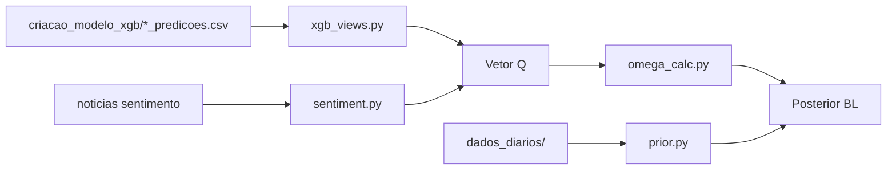

# Black-Litterman (`intel/Blacklitterman`)

Pipeline de otimização de portfólio com views **XGBoost** + sentimento. Universo vigente: **20 ações** da B3. Parâmetros oficiais em [`config.py`](config.py), alinhados a `outputs/optimize/melhorias_bl_wf_best.json` (walk-forward, **k\* = 5**, rebalance **monthly**).

Guia de leitura: [`COMO_FUNCIONA.md`](COMO_FUNCIONA.md). Mapa de saídas: [`outputs/README.md`](outputs/README.md).

## Estrutura

```
intel/Blacklitterman/
├── config.py                       # ★ Parâmetros e caminhos
├── params.py                       # BLParams (hiperparâmetros tunáveis)
├── pipeline.py                     # ★ Q → Ω → π → μ → pesos
├── xgb_views.py                    # Views Q (XGB + gate de notícias)
├── sentiment.py                    # Agregação diária do JSON GPT
├── omega_calc.py                   # Ω dinâmico + hard prior
├── prior.py                        # π, posterior BL, rebalance
├── weights.py                      # Projeção long-only com teto
├── backtest.py                     # Capital, turnover, métricas
├── plot_ganho_estimado.py
├── score_modelo.py
├── comparar_bl_vs_markowitz.py
├── otimizar_parametros.py          # Optuna (val 2024 / teste 2025)
├── aplicar_melhores_params.py
├── melhorias_bl_wf.py              # ★ k* + regularização (params vigentes)
├── sensibilidade_universo.py
├── sensibilidade_tamanho_universo.py
├── Q.py / omega.py / PI.py / PI_incerteza.py
└── outputs/
```

## Fluxo



## Como executar

```bash
cd intel/Blacklitterman

python pipeline.py
python plot_ganho_estimado.py
python score_modelo.py
python comparar_bl_vs_markowitz.py

# Pesquisa
python otimizar_parametros.py
python melhorias_bl_wf.py
python sensibilidade_tamanho_universo.py
```

## View Q

Cobertura \(c = \min(1,\ n / \texttt{NEWS\_COUNT\_MIN})\), com `NEWS_COUNT_MIN = 5`:

```
Q_h = [α + (1-α)·(1-c)] · ret_pred + (1-α)·c · sentiment_component
Q   = Q_h / h
```

| Coluna | Descrição |
|--------|-----------|
| `ret_pred` / `ret_real` | Log-retorno XGB no horizonte \(h\) |
| `Q` | View já em escala diária |
| `news_count` / `news_coverage` | Manchetes do dia e cobertura do gate |
| `q_source` | Sempre `xgb` |

α vigente = **0,386251**. Sem cobertura, Q é puro XGB. Com `HARD_PRIOR_WHEN_LOW_NEWS = True`, \(n < 5\) zera a confiança da view (dia fica no prior).

## Parâmetros vigentes

| Parâmetro | Valor |
|-----------|-------|
| Universo | 20 tickers `.SA` |
| `PERIOD_START` / `END` | 202501 / 202512 |
| `TAU` | 0,0147235 |
| `ROLLING_MIN_OBS` | 80 |
| `MAX_WEIGHT_PER_ASSET` | 0,341677 |
| `W_MODEL_CONF` / `W_NEWS_CONF` | 0,659122 / 0,340878 |
| `NEWS_OMEGA_BOOST` | 3,79598 |
| Rebalance do tuning | monthly |
| Custo / lag | 10 bps / 1 dia |
| Capital / Selic | R$ 100.000 / 15% a.a. |

## Convenções

- Config centralizado em `config.py`
- Imports `try: from .module` / `except ImportError` para pacote e script
- Pesos long-only em `weights.py`; CSV em `io_utils.py`
